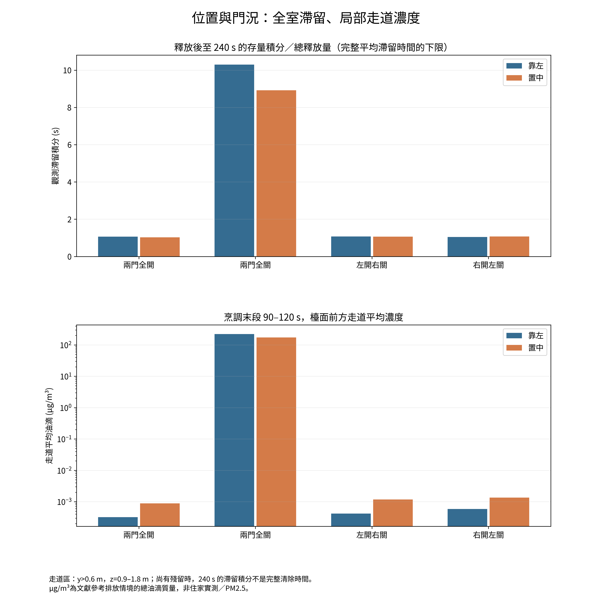

# 廚房氣流、熱浮力與中式炒菜油煙模擬

> **2026-10-21 天花沉積研究擴展：** [程式、報告及資料](ceiling_deposition/README_zh.md)。已實作逐面沉積與長期情境；**後段粗／細分支約相差27倍，尚不能作材料積油量設計值**。原v1.0.0模型與成果保留。

> **33°C／30m³/min更新：** [獨立情境與文獻依據](ceiling_deposition/scenarios/ceiling33_Q30/README.md)。新熱邊界已實作，八工況正計算；粗／細網格的20秒混合啟動診斷相差5.25倍，尚未證明網格收斂。進度以該情境的PROGRESS.json為準。

從三視圖建立廚房模型，比較兩道門的開關和灶台靠左／置中對油煙滯留的影響。專案保留初版有限元、八工況示蹤比較、櫃側受熱與材料條件比較，以及最新 OpenFOAM 油滴模型。

計算完成日期：2026-10-15；整理上傳日期：2026-10-16。這是一份**條件式數值研究，未經住家實測校準**。使用者選定公開儲存庫發布。

## 先閱讀

- [最新中文分析報告 PDF（16頁）](reports/openfoam_oil_analysis_zh.pdf)
- [九幅 1:1 圖集 PDF](reports/all_figures_1to1.pdf)
- [離線互動 3D：由 Release 下載 HTML 後開啟](https://github.com/sfhksfhk3/kitchen-airflow-cfd/releases/download/v1.0.0/kitchen_oil_openfoam_interactive_3d.html)
- [全部數據、原生模型和歷史工作快照](https://github.com/sfhksfhk3/kitchen-airflow-cfd/releases/tag/v1.0.0)
- [工作總結與版本沿革](docs/工作總結與版本沿革.md)
- [下載及重現方式](docs/下載與重現.md)

## 最新模型採用的條件

| 項目 | 條件 |
|---|---|
| 房間 | 3.3 × 1.65 × 2.2 m |
| 門 | 左右各90 × 220 cm；關門時每扇底縫5 mm |
| 灶台位置 | 靠左整體中心 x=1.15 m；可用2.6 m檯面中央 x=2.0 m |
| 爐頭 | 兩頭同時使用、相距40 cm、距後牆 y=0.3 m |
| 對空氣放熱 | 每頭2000 W，合計4000 W |
| 頂吸煙機 | 寬90 cm、深30 cm、距灶面70 cm |
| 前緣擋板 | 長10 cm、向下45°，僅煙機90 cm寬度內；零厚度擋流面 |
| 風機已知參數 | 最大風量30 m³/min、最大靜壓1300 Pa；不足以決定完整裝機曲線 |
| 計算時間 | 初始25°C；0–120 s放熱和排放；120 s停止兩者，排風至240 s |
| 油滴 | 0.1、0.3、1、3、10 µm五個獨立單粒徑響應 |

工具為 Gmsh、OpenCFD OpenFOAM 2406、自訂 `kitchenAerosolFoam`，以及 NumPy/SciPy、Matplotlib、Plotly、Chromium/Playwright。OpenFOAM採**有限體積法**，早期Python模型採scikit-fem有限元法。

熱流包括理想氣體密度、能量／動量耦合、SST湍流與浮力；已形成油滴包括沉降、布朗／湍流擴散、Talbot熱泳及壁面沉積。稀薄油滴不回饋氣流；這不代表溫度、密度與氣流被解耦。

## 最新八工況摘要

濃度使用兩爐合計14.4 mg/min、質量中位徑2.5 µm、假設GSD1.5的文獻參考情境。這是油滴總質量，**不是住家實測、PM2.5或完整超細粒子數**。走道為廚房內 y>0.6 m、z=0.9–1.8 m，沒有門外住宅走廊幾何。

| 灶台位置 | 門況 | 走道濃度 µg/m³ | 觀測滯留積分 s |
|---|---|---:|---:|
| 靠左 | 兩門全開 | 0.0003208 | 1.06 |
| 靠左 | 兩門全關 | 221.6 | 10.3 |
| 靠左 | 左開右關 | 0.0004176 | 1.069 |
| 靠左 | 右開左關 | 0.0005868 | 1.044 |
| 置中 | 兩門全開 | 0.0008821 | 1.029 |
| 置中 | 兩門全關 | 173.1 | 8.92 |
| 置中 | 左開右關 | 0.001176 | 1.065 |
| 置中 | 右開左關 | 0.001353 | 1.076 |

走道濃度為90–120 s平均；滯留積分為至240 s觀測到的空氣存量積分／總排放量，尚有殘留時只是完整平均滯留時間的下限。

在本組假設下，全關門明顯提高走道濃度和全室滯留；置中在兩門全開、左開右關時，可同時出現全室滯留略短但走道濃度較高。兩者衡量不同：前者看全室存量歷程，後者看局部空間。開門工況的大倍率也可能只是非常小的絕對濃度差，不應據此推斷健康或安全。

## 數值核對通過甚麼，仍限制甚麼

- 八個主案例和四個後段敏感性案例均已完成；顆粒質量收支通過。
- 後段110–120 s加密檢查中，雙關門走道濃度約改變2.85%（靠左）和9.28%（置中），這個窗口的排序未反轉；**不等於完整歷程網格獨立**。
- 嚴格 `checkMesh` 仍有扁長近地單元未通過項目；雙關工況的重建熱量殘差較大。小時間步與加密有改善，不能宣稱高精度熱流已收斂。
- 排風量由估計網路工作點給定，沒有完整聯立風機、煙管和濾網；室外風壓及其他建築漏風未建模。
- 沒有鍋具／板材導熱與熱容量、直接火焰／鍋具輻射、油滴蒸發／凝結／凝併、慣性撞擊。此輪不能判定真實櫃板最高溫度。

完整記錄在 [數值核對](verification/final_validation.json)、[網格檢查索引](verification/mesh_inventory.json) 和 [參數文獻](kitchen_openfoam/references/SOURCES_zh.md)。

## 儲存庫內容與完整檔案

`kitchen_sim/` 是早期1200 W試算來源；`kitchen_compare/` 是4000 W有限元／示蹤、壁面與材料分析來源；`kitchen_openfoam/` 是最新油滴求解器及後處理程式。`reports/`、`figures/`、`data/`、`verification/` 供直接閱讀。

主分支保存程式及閱讀用成果；Release保存完整逐時數據、全部原生場／檢查點及歷史工作快照。歷史9000 W試算和被拒絕的OpenFOAM試算只作追溯，不能與最新4000 W結果混用。沒有重新執行已完成的數值工作。

來源授權見 [LICENSING.md](LICENSING.md)。
