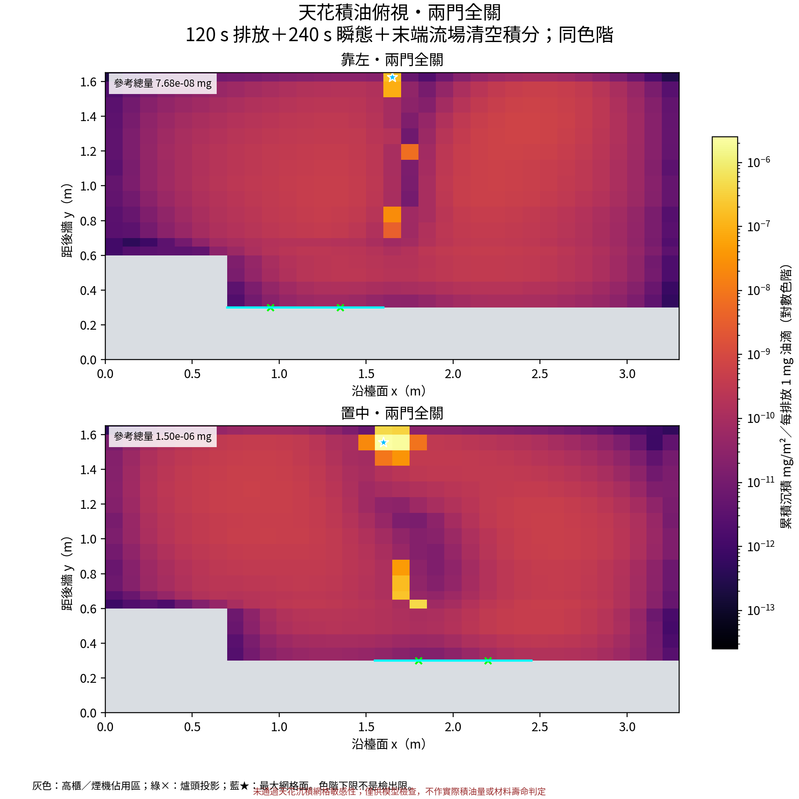
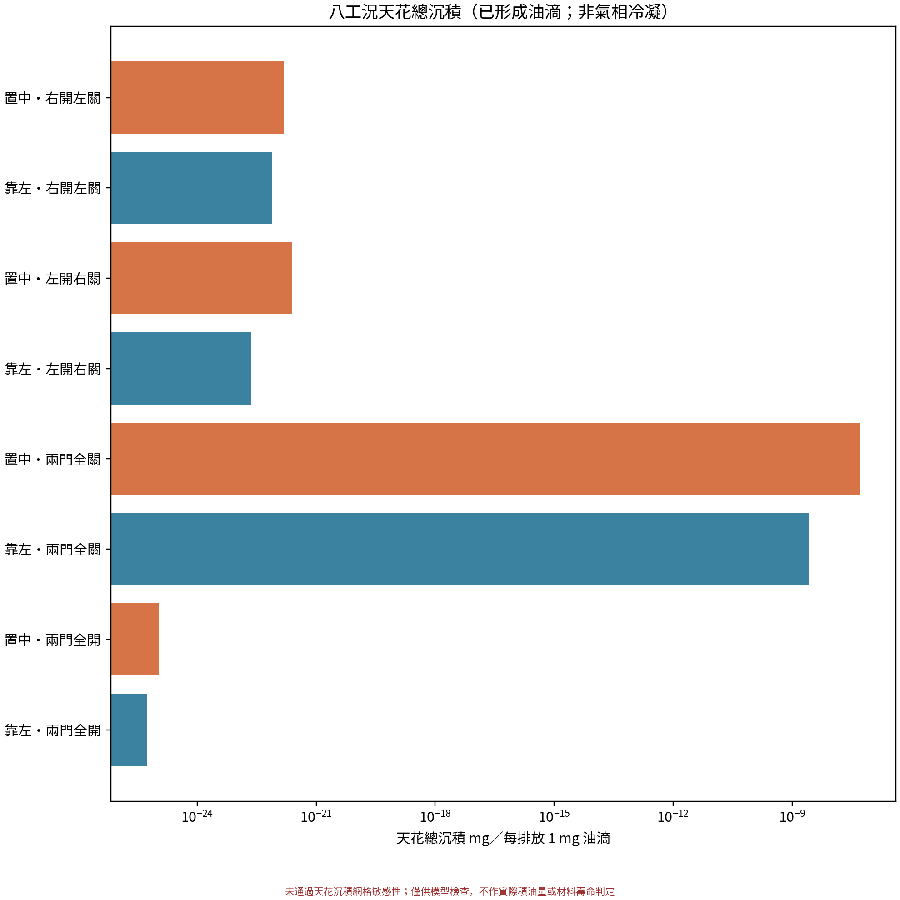
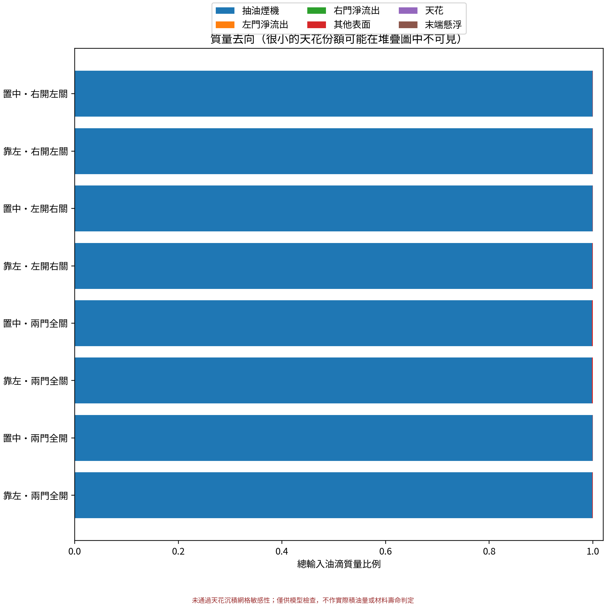
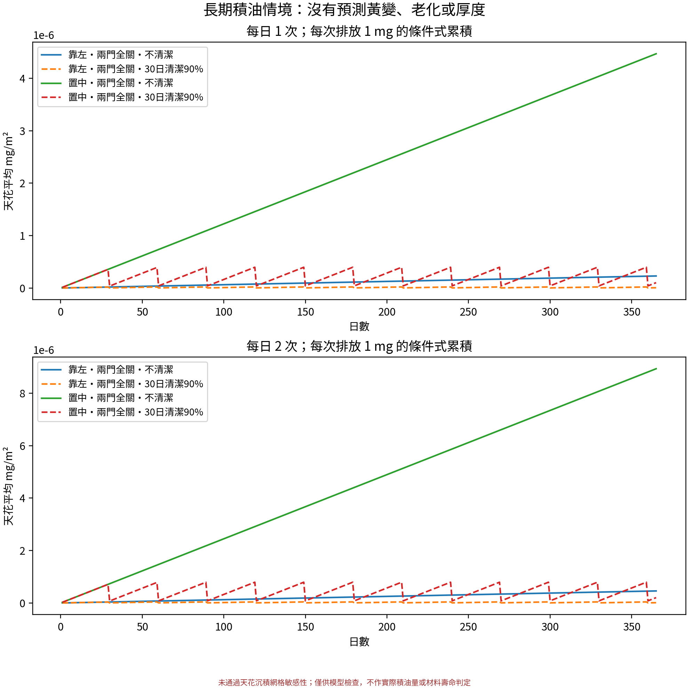
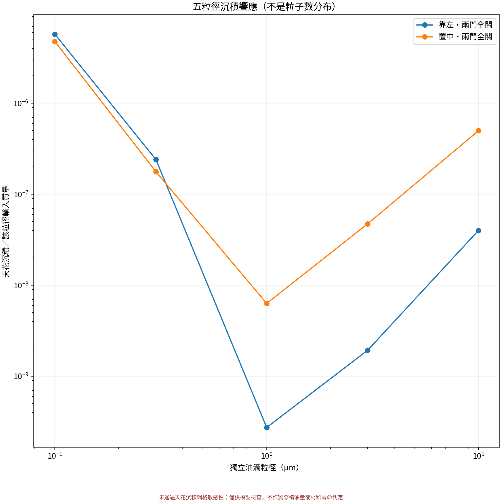
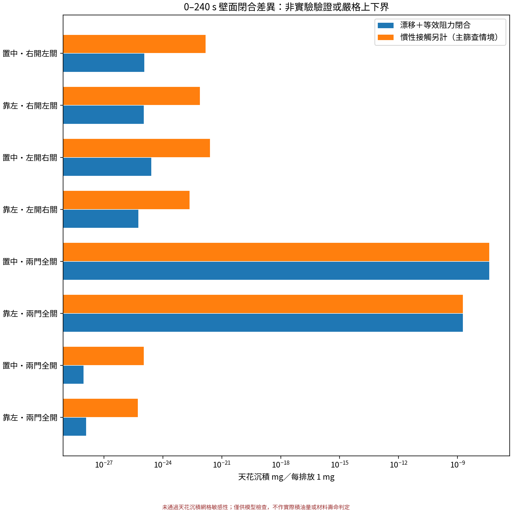

# 廚房天花油脂沉積分析

計算及整理：2026-10-21。原始基線為 v1.0.0；保留原幾何、網格、煙機設定和成果，另建立獨立的 OpenFOAM 沉積擴展。

**驗證結論：天花沉積定量未通過穩健性檢查。後段粗／細網格分支相差約27倍，10→20秒存檔間距改變約38%。細網格分支的流場歷程亦有差別，不能把全部差異歸因單一網格因素；但已足以否定目前量值可作可靠設計值。**

**本次已實作並運行真正的壁面質量通量與逐面累積，並非天花附近濃度圖。但絕對沉積量未經實測校準，不能把很小的模型值解讀成「石膏板不會積油」。本輪沒有氣態油脂冷凝或漆面黃變模型。**

## 1. 原專案審查與選擇

OpenCFD OpenFOAM 2406、自訂 buoyantPimpleFoam 衍生求解器、瞬態 PIMPLE。已有理想氣體密度／溫度／浮力／SST 湍流，兩爐各向空氣放熱2000 W。五個 Eulerian 油滴粒徑0.1/0.3/1/3/10 µm，含漂移擴散及總壁面 sink；不是純 passive scalar，亦沒有 Lagrangian parcels。完整審查在 `01_project_audit_zh.md`。

原邊界為 hood、left、right、cabinetSide、walls；天花原在 walls 內。以原面ID、法向和 z=2.2 m 分出 ceiling faceSet/faceZone，**不重排原面、重建幾何或換網格**。每個佈局的暴露天花面積由原網格量得；高櫃與上櫃覆蓋區沒有對應空氣接觸面。

採 Eulerian 延伸，可重用原生保守面通量 phi 和保存的 U/T/p/k/nut。另解油滴傳輸，避免直接以舊濃度乘一個新沉積速度而破壞收支。Lagrangian 對大滴軌跡有優點，但細滴需近壁隨機湍流、布朗力、熱泳、慣性與附著模型及粒子數收斂；單純 trap 接觸不是完整細粒子沉積模型。

## 2. 模型與時間定義

每個粒徑獨立解保守 Eulerian 輸運。壁面以布朗／van-Driest 湍流阻力、正負法向重力漂移、Talbot 熱泳、低 Stokes 數平均流慣性滑移，以及 Wood 型湍流慣性接觸閉合計算移除質量。主篩查採慣性接觸另計的 parallel 閉合；另保留等效阻力閉合作對照。管道經驗式外推至天花是重要未校準假設，不能視作精確碰撞軌跡。附著率只在粒子到達表面的輸運計算後作用，沒有把「撞牆全黏」冒充全部輸運機理。

逐面 J_dep=ρYv_dep，單位 kg/(m²·s)；M_dep=ΣJ_dep Δt，原生單位 kg/m²，匯出 mg/m²時乘10⁶。**方程中隱式移除的質量與逐面累積是同一份質量**。全體天花總量為ΣM_dep A，P95按面積加權。完整方程、資料來源與限制見 `02_physics_and_sources_zh.md`。

沿用120秒雙爐排放與加熱，120秒停止，排風觀測至240秒。240秒後尚有懸浮油滴，另在固定末端熱流場下解線性殘留清空積分（resolvent）；排出、天花和其他表面仍逐項守恆。代數正則尺度10¹²秒**不是物理煮食或觀測時間**，不製作該時間的物理動畫。主結果包含這段清空近似，並分開保存240秒觀測量和長尾份額；固定末端溫度／流場仍是模型限制。

## 3. 八工況天花結果

優先看每排放1mg的響應。絕對參考值使用兩爐合計14.4 mg/min、持續2分鐘，即28.8 mg已形成油滴；沿用質量中位徑2.5 µm、假設GSD1.5。它是商用文獻外推，**不是這個住家的排放實測、PM2.5或全部氣態油脂**。排放量另列0.25–4倍情境，非住家量測信賴區間。

| 配置 | 天花mg／排放1mg | 參考總量mg | 排放佔比% | 最大面x,y(m) |
|---|---|---|---|---|
| 靠左・兩門全開 | 5.31e-26 | 1.53e-24 | 5.31e-24 | 近零，不判讀熱點 |
| 靠左・兩門全關 | 2.67e-09 | 7.68e-08 | 2.67e-07 | 1.65, 1.62 |
| 靠左・左開右關 | 2.31e-23 | 6.66e-22 | 2.31e-21 | 近零，不判讀熱點 |
| 靠左・右開左關 | 7.66e-23 | 2.21e-21 | 7.66e-21 | 近零，不判讀熱點 |
| 置中・兩門全開 | 1.07e-25 | 3.07e-24 | 1.07e-23 | 近零，不判讀熱點 |
| 置中・兩門全關 | 5.2e-08 | 1.5e-06 | 5.2e-06 | 1.60, 1.56 |
| 置中・左開右關 | 2.5e-22 | 7.2e-21 | 2.5e-20 | 近零，不判讀熱點 |
| 置中・右開左關 | 1.5e-22 | 4.31e-21 | 1.5e-20 | 近零，不判讀熱點 |

全關門的面積統計（同一28.8mg參考排放）：

| 配置 | 平均mg/m² | P95 mg/m² | 最大mg/m² | 240s後份額% |
|---|---|---|---|---|
| 靠左・兩門全關 | 1.81e-08 | 1.56e-08 | 4.41e-06 | 28.6 |
| 置中・兩門全關 | 3.53e-07 | 1.39e-08 | 7.26e-05 | 19.6 |

**開門案例的天花沉積小到不足以作工程量化；不按其指數、倍率或最大面位置判斷材料風險。顏色即使有明顯相對差異，也不代表可見積油。** 在主篩查假設下，較大天花沉積出現在全關門；最大片區位置以CSV與下圖為準。這不表示全室暴露與天花沉積總會同方向變化。

綠×為爐頭投影，藍星為模型最大網格面，灰色為櫃體佔用區；天花最大點不必正對爐頭，取決於到達天花的油滴供應、近壁氣流、溫差和沉積速度。單一網格面極值不等於已定位的實際污漬。

## 4. 抽走、懸浮與其他表面

逐步輸出抽油煙機、左右門淨流出、天花、其他表面及懸浮，開口採求解矩陣的實際數值通量。殘留清空後仍剩的代數殘量沒有被強行配給天花。完整去向見 `primary_complete_event_summary.csv`、各案例 `size_mass_balance.csv` 和原生 `ceiling_budget.csv`。

## 5. 提高抽風量的實際試驗

沒有縮放舊U冒充新CFD：從約100秒同一檢查點，重新解原風量對照及目標增20%的熱流，保留1300 Pa壓力上限，求解至140秒，再以相同舊油滴初始場比較沉積。這是**相同重啟的短時控制試驗，不是整次煮食從0秒提高風量**；初始油滴來自舊模型，因此此處的mg不可與第3節的新模型完整事件直接相加或比較。

| 位置 | 實際Q增幅% | 對照mg | 增風mg | 天花沉積減幅% |
|---|---|---|---|---|
| 靠左 | 20 | 3.43e-07 | 3.09e-06 | -801 |
| 置中 | 20.1 | 1.81e-07 | 3.8e-06 | -2e+03 |

「沉積減幅」負值表示這個短時試驗增加。當絕對量極小，龐大百分比不應當作有實用精度的風險差異。較強排風會改變流線、油滴在天花附近的供應和慣性接觸；本輪不支持宣稱風量增加20%便按比例減少天花積油。要量化整頓飯的改善，需量測裝機風量／補風，再做全歷程不同工作點的耦合試驗。

## 6. 30／180／365日累積與清潔

配置檔 `config/long_term.json` 提供每日1／2次、每次1mg單位排放、7.2／28.8／115.2mg三個絕對情境、無清潔與每30日清潔情景。清潔在當日烹調後進行，分別輸出清潔後保留量和清潔前峰值，效率0.5／0.9／0.99只是可改假設。

以相同短事件反覆累積，不含自然掉落、再懸浮、氧化、油膜改變附著率或氣態冷凝。**不是幾個月會發黃、幾微米油膜或漆膜壽命預測。** 如果一頓飯的排放歷程與此120秒案例不同，應更換每次排放劑量並檢查新的流場歷程，不能無條件按烹調分鐘數外推。

以下僅為28.8mg/次、附著率1、全關門的條件式量值。所有材料在同一附著率與清潔效率下數值相同：

| 位置 | 日數 | 每日次數 | 清潔 | 保留總量mg | 平均mg/m² | 清潔前峰值平均mg/m² |
|---|---|---|---|---|---|---|
| 置中 | 30 | 1 | 無 | 4.49e-05 | 1.06e-05 | 1.06e-05 |
| 置中 | 30 | 1 | 30日/90% | 4.49e-06 | 1.06e-06 | 1.06e-05 |
| 置中 | 180 | 1 | 無 | 0.000269 | 6.35e-05 | 6.35e-05 |
| 置中 | 180 | 1 | 30日/90% | 4.99e-06 | 1.18e-06 | 1.18e-05 |
| 置中 | 365 | 1 | 無 | 0.000546 | 0.000129 | 0.000129 |
| 置中 | 365 | 1 | 30日/90% | 1.25e-05 | 2.94e-06 | 1.18e-05 |
| 置中 | 30 | 2 | 無 | 8.98e-05 | 2.12e-05 | 2.12e-05 |
| 置中 | 30 | 2 | 30日/90% | 8.98e-06 | 2.12e-06 | 2.12e-05 |
| 置中 | 180 | 2 | 無 | 0.000539 | 0.000127 | 0.000127 |
| 置中 | 180 | 2 | 30日/90% | 9.98e-06 | 2.35e-06 | 2.35e-05 |
| 置中 | 365 | 2 | 無 | 0.00109 | 0.000257 | 0.000257 |
| 置中 | 365 | 2 | 30日/90% | 2.49e-05 | 5.88e-06 | 2.35e-05 |
| 靠左 | 30 | 1 | 無 | 2.3e-06 | 5.43e-07 | 5.43e-07 |
| 靠左 | 30 | 1 | 30日/90% | 2.3e-07 | 5.43e-08 | 5.43e-07 |
| 靠左 | 180 | 1 | 無 | 1.38e-05 | 3.26e-06 | 3.26e-06 |
| 靠左 | 180 | 1 | 30日/90% | 2.56e-07 | 6.03e-08 | 6.03e-07 |
| 靠左 | 365 | 1 | 無 | 2.8e-05 | 6.6e-06 | 6.6e-06 |
| 靠左 | 365 | 1 | 30日/90% | 6.4e-07 | 1.51e-07 | 6.03e-07 |
| 靠左 | 30 | 2 | 無 | 4.61e-06 | 1.09e-06 | 1.09e-06 |
| 靠左 | 30 | 2 | 30日/90% | 4.61e-07 | 1.09e-07 | 1.09e-06 |
| 靠左 | 180 | 2 | 無 | 2.76e-05 | 6.51e-06 | 6.51e-06 |
| 靠左 | 180 | 2 | 30日/90% | 5.12e-07 | 1.21e-07 | 1.21e-06 |
| 靠左 | 365 | 2 | 無 | 5.61e-05 | 1.32e-05 | 1.32e-05 |
| 靠左 | 365 | 2 | 30日/90% | 1.28e-06 | 3.02e-07 | 1.21e-06 |

## 7. 材料比較

| 選項 | CFD能比較 | 應另查的實際資料 |
|---|---|---|
| 防潮石膏板＋普通啞光乳膠漆 | 同一α範圍下的油滴附著量 | 漆膜耐擦洗、耐油污、清潔劑相容性；防潮板不等於防油或可反覆濕擦 |
| 防潮石膏板＋耐擦洗Satin廚衛漆 | 同上；不憑光澤指定較低α | 實際產品耐擦洗／耐污資料與施工、通風要求；亦有耐油污的啞光配方 |
| 烤漆鋁板 | 同上；塗層未校準α | 塗層和清潔劑相容、接縫、可拆洗性；不能假定鋁板表面的塗層永不老化 |

附著率α=0.1／0.5／1在靠左與置中兩個全關門案例實際重新求解；開門案例只保留α=1，因其量值已不足以作材料定量比較。三種材料共用這個掃描範圍，沒有足夠資料為任何一種排黏附率名次。CFD相同α的結果重合是正確呈現未知，不是漏做材料差異。可擦洗性和方便清潔不等於低沉積率。基於維護規格，應優先選擇有實際耐擦洗／耐油污文件且可方便維護的系統；此建議來自材料資料，並非CFD預測塗料老化。

一手材料資料：[Gyproc防潮板](https://www.gyproc.ie/documents/product-datasheets/pds-gyproc-ireland-moisture-resistant.pdf)、[Benjamin Moore廚衛Satin TDS](https://media.benjaminmoore.com/WebServices/prod/assets/production/datasheets/TDS_0322/W322_TDS_US.pdf)、[Dulux Kitchen Matt](https://www.dulux.co.uk/en/products/dulux-easycare-kitchen-matt/cccId_1935922)、[金屬吊頂清潔維護](https://assets.hunterdouglasarchitectural.eu/documents/ceiling/Installation%20Manuals/_default/Cleaning-and-Maintenance-Luxalon-multipanel.pdf)。它們都不提供本廚房的油滴附著率量測。

## 8. 實際驗證結果與可信程度

低成本20秒流程先通過才進入正式批次。量綱、零漂移／順逆重力極限、混合箱收支、非負濃度、逐面積分、VTK讀取和每步油滴質量收支已核對。完成瞬態案例43個，清空積分13個。最差瞬態相對收支誤差3.43e-11，清空積分6.52e-11。這是**離散收支驗證，不是物理實驗驗證**。

| 測試 | 適用時段／範圍 | 沉積變化% |
|---|---|---|
| corner_time_step_0.1_to_0.05 | full 0–240 s aerosol replay | 9.09 |
| corner_late_mesh_refinement | 110–140 s short source pulse, existing coarse/fine coupled flows; not full-history grid independence | 2.66e+03 |
| center_time_step_0.1_to_0.05 | full 0–240 s aerosol replay | -1.08 |
| center_late_mesh_refinement | 110–140 s short source pulse, existing coarse/fine coupled flows; not full-history grid independence | 2.63e+03 |
| corner_window_ScT05 | 110–140 s matched-window aerosol/closure sensitivity | 20.9 |
| corner_window_ceiling_cold5 | 110–140 s matched-window aerosol/closure sensitivity | 1.67 |
| corner_window_no_thermo | 110–140 s matched-window aerosol/closure sensitivity | -0.0728 |
| corner_window_no_inertia | 110–140 s matched-window aerosol/closure sensitivity | -99.2 |
| corner_window_frames20 | 110–140 s matched-window aerosol/closure sensitivity | 38 |
| corner_window_coeff05 | 110–140 s matched-window aerosol/closure sensitivity | -0.00649 |
| corner_window_ceiling_warm5 | 110–140 s matched-window aerosol/closure sensitivity | -0.548 |
| corner_window_quad144 | 110–140 s matched-window aerosol/closure sensitivity | 0.0179 |
| heat_to_air_off_from100 | 100–140 s matched coupled-air intervention; warm initial state and emissions until120 retained | -0.0294 |

時間步比較為完整0–240秒；參數與加密比較為110–140秒的匹配短排放試驗。細網格使用原專案已有約3萬單元案例；它們的氣流也由舊敏感性分支取得，沒有完成0–240秒全歷程網格獨立。嚴格checkMesh仍有2項未通過；主粗網格的天花剪力估算y+最大約85，首層法向距離最大約5.6 cm，並非y+≈1完整解析，故沉積依賴近壁閉合。最大10µm的低Stokes滑移近似在門縫高速區會受限。

原熱流的雙關門熱量重建殘差較大；重播原始存檔不能修復原熱流誤差，10秒存檔間距也丟失未保存的瞬態，尤其首個0–10秒不能還原快速的風機啟動與熱羽流建立。風機工作點仍由網路假設給定，未聯立實測完整風機／煙管／濾網曲線。**絕對積油與材料壽命判斷可信度低；程式可運行和質量守恆的可信度較高。若加密或閉合使極小沉積大幅改變，就不能將小數字當作可靠上限。**

## 9. 最後六個問題

1. **哪裡最容易積油？** 在本次已形成油滴的主情境中，全關門較值得注意；最大面位置見第3節座標及熱圖。置中／靠左的熱點取決於近壁輸運，不只看爐頭正上方。開門的近零值不足以定位真實污漬。
2. **單次多少？** 第3節列出每排放1mg及28.8mg參考排放的條件量，已含末端流場殘留清空近似。它不是實測一頓飯，更不包含氣態物質冷凝。
3. **哪些假設最影響？** 實際排放劑量與粒徑分布、門／補風和裝機風量、天花溫差、近壁模型／網格、慣性與附著率，及未建模的氣態凝結。敏感度數字見第8節，不能用質量守恆誤差代替這些不確定性。
4. **增風改善多少？** 約100–140秒匹配試驗的實際Q與沉積變化見第5節；不保證單調改善，不能當整頓飯的改善百分比。
5. **石膏板吊頂會否有長期清潔問題？** 本輪無法排除。極低的油滴沉積不包含蒸氣／半揮發性有機物的表面吸附凝結，也未預測漆面變色。應按頻繁炒菜的維護需求選耐擦洗、耐油污且可維修的表面，不能由此宣稱普通啞光石膏吊頂長期免清潔。
6. **還需量甚麼？** 裝機風量／煙管壓差、門口補風速度；每次炒菜的油滴總質量和質量粒徑分布；天花溫度隨時間；在圖示熱點與低區放置已稱重的材料試片，按多次相同烹調測沉積及清潔後殘留；若要納入凝結，另量氣相／粒相有機物組成和分配。以同場三種塗層試片校準α及清潔效率，才可量化長期積油差異。

## 10. 交付索引

README列出完整執行步驟。`results/` 含逐面CSV、原生ID、PVD/VTP、五粒徑及混合質量收支、長期情景與敏感度表；`figures/` 含1:1 PNG/PDF圖集；`ceiling_deposition_interactive_3d.html` 可完全離線操作。`runs/` 和 `flow_sensitivity/` 保存新案例，不覆蓋 v1.0.0 原始成果。物理模型和一手文獻完整列表在 `02_physics_and_sources_zh.md`。

## 附錄A：新氣流分支的收支限制

| 新氣流分支 | 後段實際Q m³/s | 重建能量收支RMS W |
|---|---|---|
| corner_both_closed_Qtarget120 | 0.27 | 56.2 |
| center_both_closed_Qtarget120 | 0.27 | 18.4 |
| center_both_closed_control | 0.225 | 114 |
| corner_both_closed_control | 0.225 | 266 |
| corner_both_closed_heatOff100 | 0.226 | 10.5 |

這是診斷式重建殘差，不等於經實測的能量誤差；原風量對照的熱量殘差仍不可忽略，未被油滴收支良好所修復。

## 附錄B：完整物理模型與一手來源

# 沉積物理、方程與資料依據

## 保守方程和逐面質量

每個粒徑分別求解：∂(ρY)/∂t + ∇·[(ρU+ρv_d)Y] − ∇·[ρ(D_B+ν_t/Sc_t)∇Y] = S − Σ_face[ρv_dep A/V]Y。

Y 為無因次質量分率；原生 phi 為 kg/s；D_B、ν_t 為 m²/s；v_dep 為 m/s。壁面不是以靠近天花濃度代替沉積：在離散方程以隱式 sink 移除的同一份質量，按面分配 J_face=ρYv_dep（kg/(m²s)），M_face←M_face+Δt J_face（kg/m²）。輸出 mg/m² 時乘10⁶。天花總沉積=Σ M_face A_face。所有牆面 sink 加總與油滴收支逐步核對；開口採矩陣的數值通量，避免另估邊界通量不守恆。

## 壁面近似

D(y)=D_B+κu_τ y[1−exp(−y⁺/26)]²/Sc_t；R=∫₀^δdy/D(y)，以72段對數積分。u_τ 使用保存 U、nut 的壁面剪應力近似 sqrt[(ν+ν_t,wall)|U_t|/δ]，不是宣稱高精度量測壁面剪力。

法向朝固體為正。漂移含重力（天花為負，不能直接忽略）、Talbot 熱泳、低 Stokes 數平均流慣性滑移 −τ_p DU/Dt。可選顯式湍泳近似預設關閉，避免與湍流慣性經驗閉合重複。

湍流慣性輸運採 Wood 型 v_imp=u_τ min[0.13,4.5×10⁻⁴(τ_pu_τ²/ν)²]。這個公式來自管道沉積，移植至廚房天花未經校準；不能因寫入方程就稱「真實慣性碰撞已驗證」。阻力對照閉合以 R_eff=1/(1/R+v_imp)，v_dep=α v_n/[1−exp(−v_n R_eff)]；v_n→0 時回到 α/R_eff，逆重力時沉積受抑制。主篩查採把 v_imp 與漂移阻力通量相加的 parallel 閉合：慣性接觸不應被當作布朗擴散而必須通過同一薄層阻力。這仍是管道經驗式的天花外推，對慣性接觸中的逆重力影響並非精確軌跡計算；兩種閉合均保留作不確定性比較，不是嚴格數學上下界。

天花溫度使用既有熱邊界值；±5 K 敏感度只變粒子熱泳驅動，不重解固體或氣流熱場。這不是石膏板和鋁板的熱傳比較。Sc_t、附著 α、熱泳、慣性、近壁積分及時序插值均有實際計算檢查。

## A / B 方法比較

採 Eulerian：五粒徑可直接延伸，沒有極小沉積事件的有限粒子抽樣噪音，成本為每步五個標量方程。可重用原 U/T/k/nut/phi，但 10 s 保存間距未包含未保存的瞬態細節。Lagrangian 需要近壁非均勻隨機湍流、布朗力/熱泳、慣性和附著模型；trap 只處理已接觸壁面的粒子，不能代替細粒子走到壁面的機理。沒有做 Lagrangian 粒子數收斂，也不把它列作本輪驗證通過項目。

## 油滴與冷凝分開

本輪只追蹤已形成、定密度球形油滴。氣態/半揮發性有機物的表面凝結、吸附、氣粒分配、化學轉化沒有建模。不能以牆溫較低便把氣態濃度全算成沉積；需組分排放、飽和蒸氣壓/活度、表面傳質及表面溫度。亦未計靜電、漆面微觀粗糙度、反彈/再懸浮、油膜改變黏附和長期老化。

## 一手來源與適用限制（2026-10-21查閱）

- [Lai & Nazaroff 2000](https://doi.org/10.1016/S0021-8502(99)00536-4)：室內光滑面布朗/湍流擴散與沉降。本次是阻力近似，不是逐式重現。
- [Sippola & Nazaroff, LBNL report, Particle Deposition from Turbulent Flow: Review of Published Research and Its Applicability to Ventilation Ducts in Commercial Buildings](https://www.osti.gov/servlets/purl/815478)，4.3.2–4.3.4、式53及71–74：Wood係數、水平面方向與管道外推限制。本次 hybrid closure 另作假設，不宣稱等同報告模型。
- [Guha 2008](https://doi.org/10.1146/annurev.fluid.40.111406.102220)：統一 Eulerian / Lagrangian 沉積機理及適用邊界。
- [Talbot et al. 1980](https://doi.org/10.1017/S0022112080001905)：熱泳係數；沿用既有油滴導熱率0.17 W/(m K)。
- [Applied Sciences 2022,12,8896](https://www.mdpi.com/2076-3417/12/17/8896)：原專案採0.12 mg/s/頭的商用油滴來源。兩頭14.4 mg/min只作參考，另列0.25–4倍；不是這個住家的量測或通用中式炒菜排放率。
- [Chen et al. 2023](https://pubmed.ncbi.nlm.nih.gov/37847366/)：六道中式菜的粒徑/捕集實驗；沿用質量中位徑2.5 µm、假設GSD1.5，另以GSD1.2/2.0重組。沒有把PM2.5量測當作全部純油脂。
- [Gyproc moisture-resistant board 資料](https://www.gyproc.ie/documents/product-datasheets/pds-gyproc-ireland-moisture-resistant.pdf)：防潮板的使用條件不等於防油或可無限濕擦。
- [Benjamin Moore Kitchen & Bath Satin W322 TDS](https://media.benjaminmoore.com/WebServices/prod/assets/production/datasheets/TDS_0322/W322_TDS_US.pdf)：特定廚衛漆產品用途；不提供油滴黏附率，不能把廚衛適用轉成 CFD α 數值。
- [Dulux Kitchen Matt](https://www.dulux.co.uk/en/products/dulux-easycare-kitchen-matt/cccId_1935922)：有耐油污的啞光配方，顯示不能只按光澤判斷性能；普通啞光需查實際產品的耐擦洗規格。
- [Hunter Douglas 金屬吊頂清潔維護](https://assets.hunterdouglasarchitectural.eu/documents/ceiling/Installation%20Manuals/_default/Cleaning-and-Maintenance-Luxalon-multipanel.pdf)：應依實際塗層和清潔劑相容性維護；這不是所有烤漆鋁板的沉積率量測。

三種表面都以相同 α=0.1/0.5/1 掃描；無資料支持任何材料的 α 排名。清潔模型同樣不預設某材料有較高效率。材料比較的可靠部分是產品獨立規格與可維護性，並非 CFD 預測漆面黃變、老化或可擦洗性。

## 停止煮食後的清空積分

240 s 仍有懸浮油滴；以固定末端熱流場解線性輸運的殘留清空 resolvent，逐面累積後續 sink，剩餘質量仍列帳。代數尺度 H=10¹² s 不是物理觀測時長，另以10⁹檢查正則敏感度。這可避免把所有剩餘量都配給天花或完全忽略它，但固定殘餘熱場仍是近似；詳見 README。
