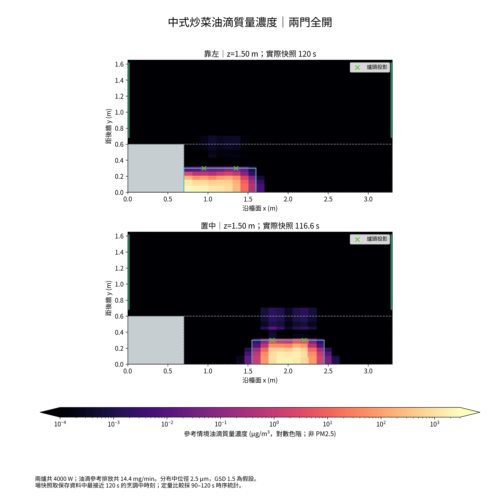
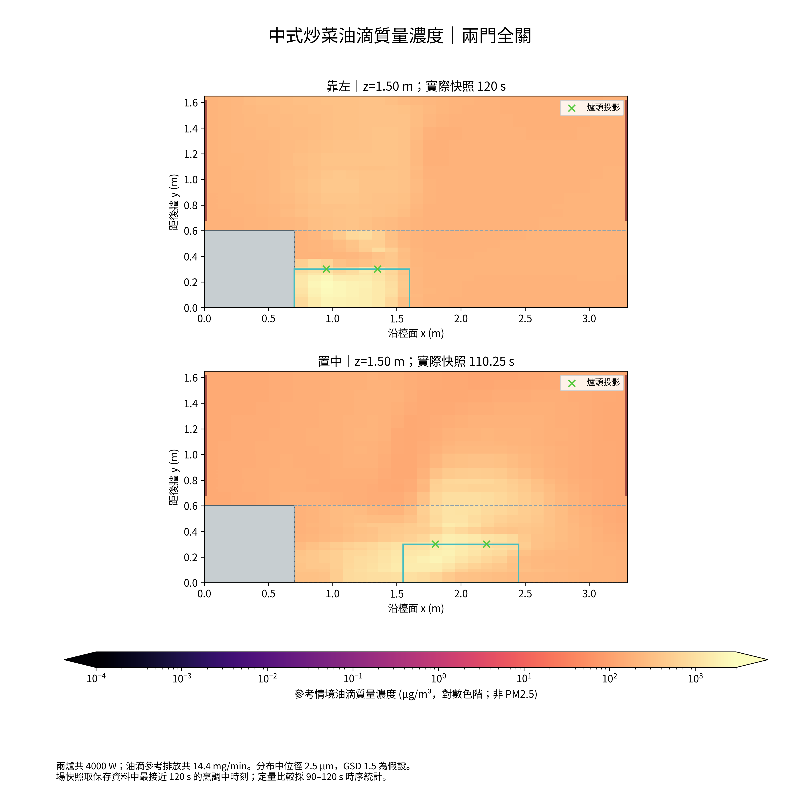
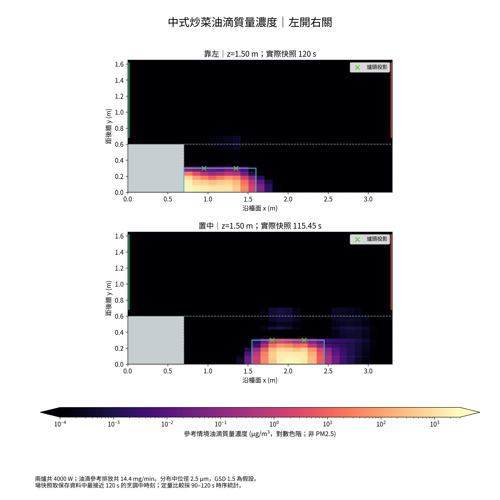
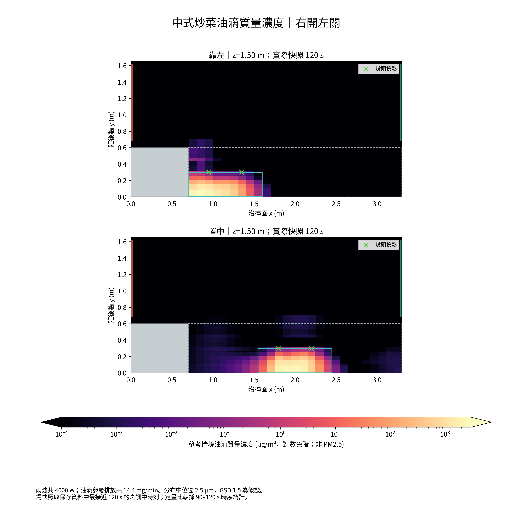
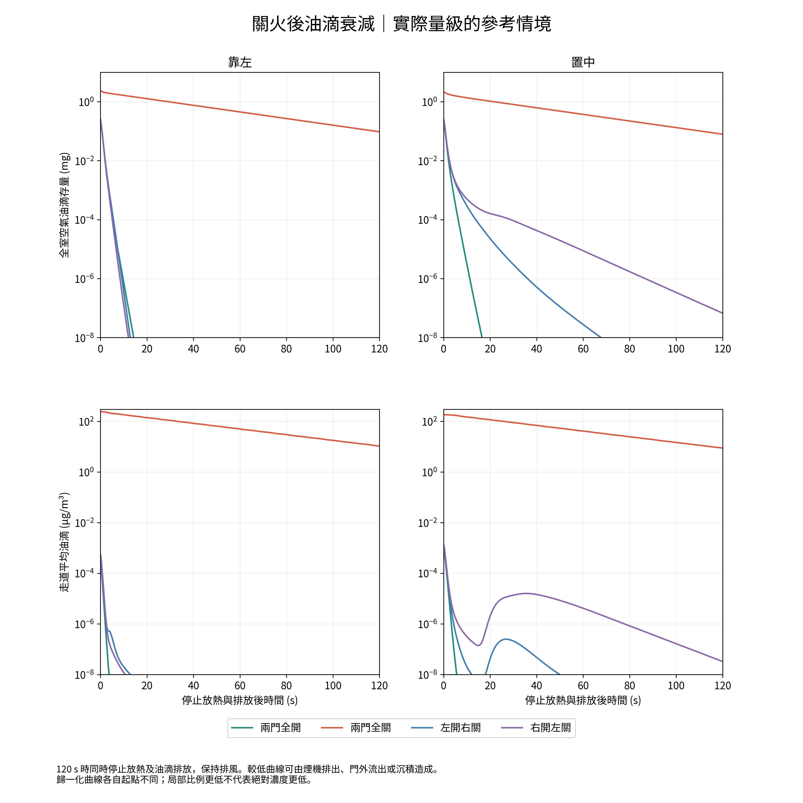
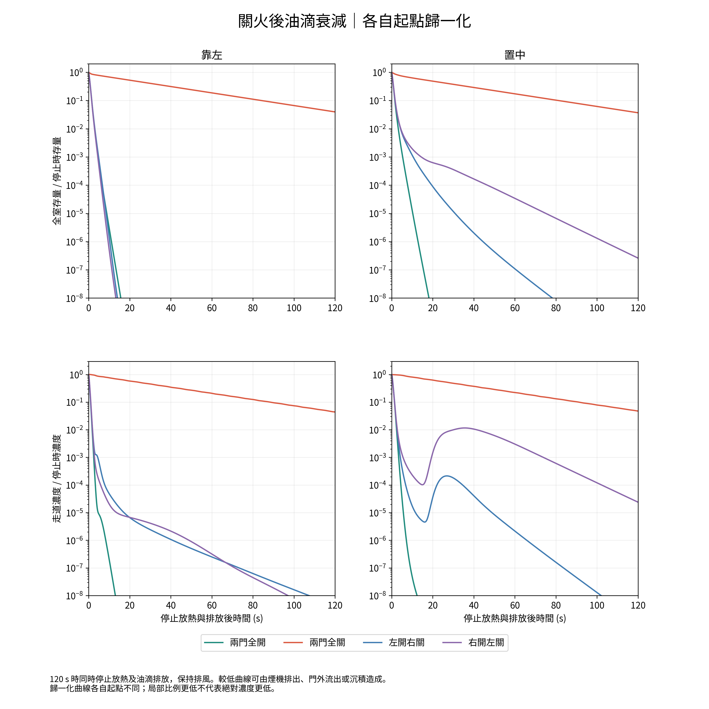
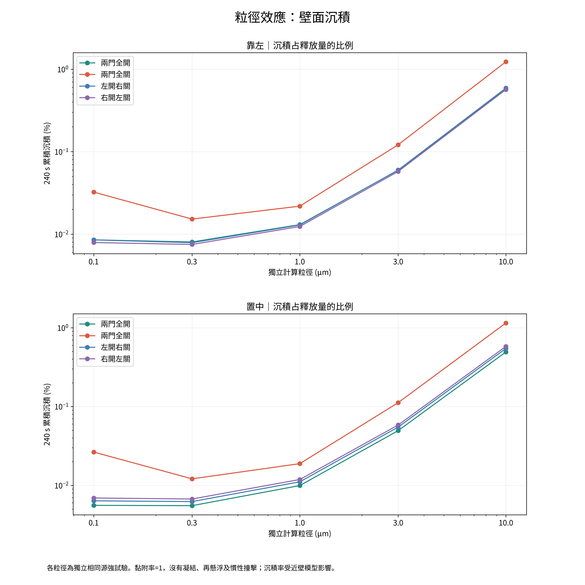
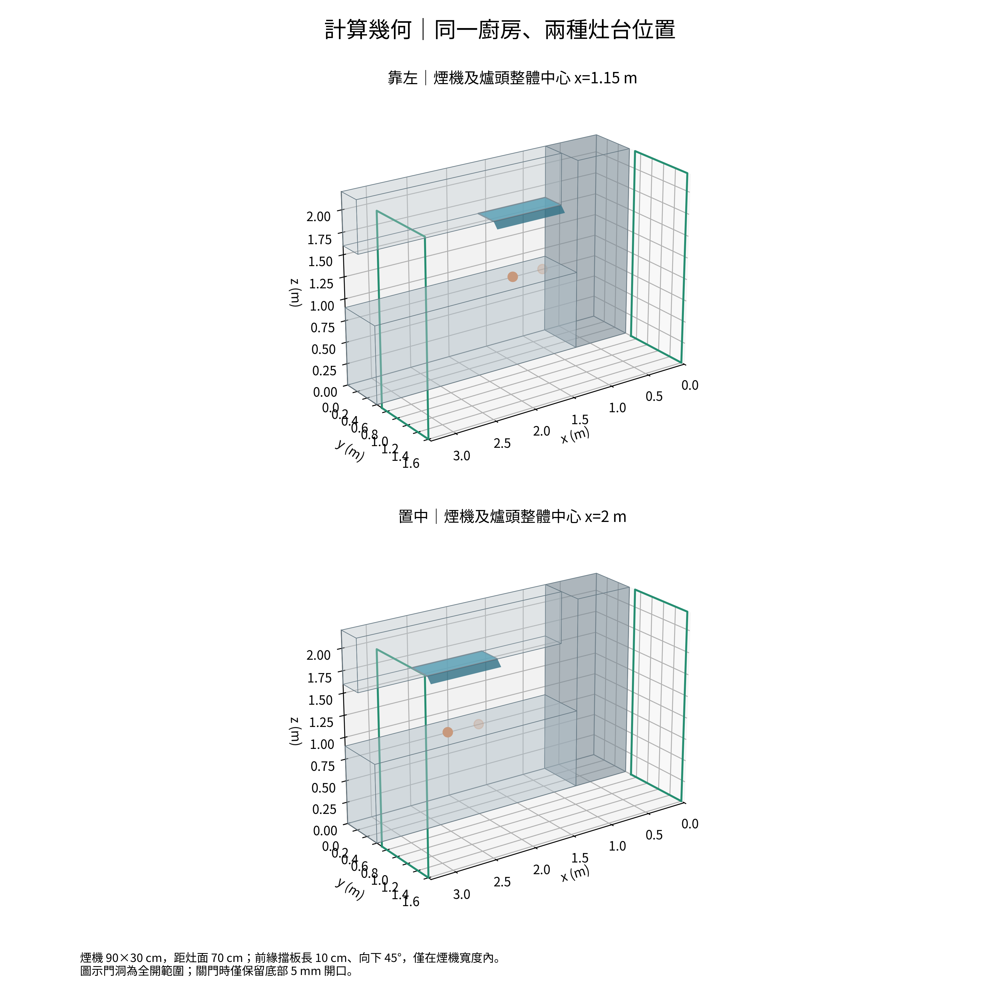

# 廚房油滴與熱浮力：OpenFOAM 八工況比較

2026-10-15｜條件式數值分析｜兩爐對空氣顯熱合計 4000 W

本次沿用已確認的廚房尺寸，以 OpenCFD OpenFOAM 2406 的有限體積法，計算靠左及置中位置、各四種門況。模型包含溫度—密度—氣流耦合、k–ω SST，以及分粒徑油滴的沉降、擴散、熱泳和壁面沉積。舊版有限元資料保留，這份報告的表格取自新的 OpenFOAM 計算。

以下濃度採文獻參考排放情境，不能視為此住家的實測濃度。未經校準的風機工作點、近壁湍流、油滴源分布及材料熱邊界仍會影響結果；軟體轉換本身不構成實驗驗證。

本輪關火後的熱流也隨時間改變；先前固定熱流場上的示蹤衰減和這次設定不同。兩輪數據的差值不能全部歸因於更換求解器或加入油滴。

## 1. 先看八個工況

走道區指廚房內檯面前方 y>0.6 m、z=0.9–1.8 m，不是門外走廊末端。走道濃度採烹調末段90–120秒的平均；滯留積分採完整觀測到240秒的空氣存量積分除以總釋放量，尚有殘留時是完整平均滯留時間的下限。

| 位置 | 門況 | 抽風 m³/min | 走道油滴 µg/m³ | 觀測滯留積分 s | 經煙機離室 % | 沉積 % |
|---|---|---|---|---|---|---|
| 靠左 | 兩門全開 | 30 | 0.0003208 | 1.06 | 99.94 | 0.06495 |
| 靠左 | 兩門全關 | 13.55 | 221.6 | 10.3 | 99.54 | 0.1323 |
| 靠左 | 左開右關 | 30 | 0.0004176 | 1.069 | 99.93 | 0.06529 |
| 靠左 | 右開左關 | 30 | 0.0005868 | 1.044 | 99.94 | 0.06268 |
| 置中 | 兩門全開 | 30 | 0.0008821 | 1.029 | 99.95 | 0.05399 |
| 置中 | 兩門全關 | 13.55 | 173.1 | 8.92 | 99.6 | 0.1225 |
| 置中 | 左開右關 | 30 | 0.001176 | 1.065 | 99.94 | 0.05983 |
| 置中 | 右開左關 | 30 | 0.001353 | 1.076 | 99.94 | 0.06364 |

濃度使用兩爐總油滴排放14.4 mg/min、質量中位徑2.5 µm、GSD1.5的參考情境。煙機排出比例表示顆粒經吸口離開計算室內，不是濾網淨化效率或未逸散的直接捕集率。

*全室滯留與局部走道濃度分別比較；兩者衡量不同。*

## 2. 靠左與置中各有甚麼差別

| 門況 | 置中／靠左走道濃度 | 置中滯留積分相對變化 | 走道絕對差 µg/m³ |
|---|---|---|---|
| 兩門全開 | 2.75 倍 | -2.976% | 0.0005613 |
| 兩門全關 | 0.7812 倍 | -13.37% | -48.48 |
| 左開右關 | 2.815 倍 | -0.3438% | 0.000758 |
| 右開左關 | 2.306 倍 | 3.131% | 0.0007665 |

在兩門全開、左開右關中，置中的觀測滯留積分較短，走道平均濃度卻較高。全室指標取決於所有顆粒留在房內的時間；局部走道濃度取決於有多少顆粒進入該區。少量顆粒偏向走道，已可提高局部濃度，並不要求全室總量同時增加。

靠左的高櫃會限制源區左側的氣流空間；置中改變了兩側補風到煙機的路徑。因此，位置效果需要連同門況判斷。當走道濃度已接近零，大倍率也可能對應很小的絕對差，應同時讀取上表的絕對量。

本輪保留每一門況的數值排序，但後段網格／時間步檢查只覆蓋部分工況，不能把小幅優勢定成普遍結論，也不能僅據這份模擬決定搬動灶台。補風路徑與實際運轉風量應優先確認。

## 3. 關門為何明顯改變氣流

兩扇門全關時，合計5mm底縫面積只有0.009 m²；按估計抽風工作點0.226 m³/s，等密度換算平均補風速度約25 m/s。完整熱流計算因排氣升溫膨脹，實際門縫速度略有差異。全開時補風面積大得多，入口平均速度低。高速近地噴流與熱羽流、櫃體和房間回流相互作用，不能只用「換氣次數」判斷灶台附近的流向。

5mm開口採實際幾何，基準高度兩個單元；加密檢查採四個。這仍不足以宣稱門縫近壁流動已完全收斂。其他門框、窗戶及建築漏風在此未建模。

在靠左位置，本輪基準計算的走道末段濃度最低為兩門全開（0.0003208 µg/m³），最高為兩門全關（221.6 µg/m³）。這是本模型與排風假設下的比較，並非實測操作保證。

在置中位置，本輪基準計算的走道末段濃度最低為兩門全開（0.0008821 µg/m³），最高為兩門全關（173.1 µg/m³）。這是本模型與排風假設下的比較，並非實測操作保證。

*兩門全開：距地1.5m水平切面；圖中標示實際保存時刻，綠色叉是爐頭位置的平面投影。*

*兩門全關：距地1.5m水平切面；圖中標示實際保存時刻，綠色叉是爐頭位置的平面投影。*

*左開右關：距地1.5m水平切面；圖中標示實際保存時刻，綠色叉是爐頭位置的平面投影。*

*右開左關：距地1.5m水平切面；圖中標示實際保存時刻，綠色叉是爐頭位置的平面投影。*

## 4. 熄火後衰減、空氣殘留與沉積

120秒時停止對空氣放熱與油滴排放，煙機繼續運轉至240秒。沒有鍋具和板材的固體餘熱，因此這是理想化關火過程。下表的95%下降是相對停止時的各自存量或濃度；沒有到達的項目只記錄觀測窗內未到達。

| 位置 | 門況 | 全室95%下降 | 走道95%下降 | 240s仍在空氣 % | 經兩門離室 % |
|---|---|---|---|---|---|
| 靠左 | 兩門全開 | 1.92 s | 1.223 s | 2.74e-20 | 1.391e-18 |
| 靠左 | 兩門全關 | 111 s | 115.4 s | 0.3322 | 2.03e-05 |
| 靠左 | 左開右關 | 1.956 s | 1.263 s | 4.277e-14 | 8.12e-20 |
| 靠左 | 右開左關 | 1.889 s | 1.326 s | 1.264e-14 | 1.102e-19 |
| 置中 | 兩門全開 | 2.017 s | 1.679 s | 2.274e-16 | 3.218e-15 |
| 置中 | 兩門全關 | 108.2 s | 118.1 s | 0.2753 | 1.592e-05 |
| 置中 | 左開右關 | 2.291 s | 1.765 s | 4.552e-11 | 1.2e-19 |
| 置中 | 右開左關 | 2.294 s | 1.767 s | 2.329e-07 | 2.331e-09 |

經兩門離室只是離開廚房計算域，並不代表整戶污染已消失；本模型沒有門外住宅空間。壁面沉積會降低空氣濃度，同時留下表面油污。精確延遲關機秒數仍受網格、混合、烹調源和實際補風影響，表中時間不應直接當成家用煙機的操作延時建議。

*四幅合併：靠左／置中 × 全室空氣存量／走道濃度，保留絕對量級。*

*各曲線各自起點歸一化；相對比例的交叉不等於絕對濃度同時交叉。*

## 5. 從氣體示蹤轉為油滴模型

熱流方程使用理想氣體密度ρ(p,T)、溫度相關黏度、動量及能量耦合。油滴則為稀薄球粒子，以五個獨立粒徑的質量分率Y分別求解：

`∂(ρY)/∂t + ∇·[(ρu + ρv漂移)Y] = ∇·[ρ(DB + νt/Sc_t)∇Y] + S − 壁面沉積`

漂移包含Stokes–Cunningham沉降與Talbot熱泳。DB為Stokes–Einstein布朗擴散。壁面通量由含van Driest阻尼的擴散阻力積分，加向壁的沉降／熱泳通量形成，以正的隱式損失項求解；黏附率設為1。這不是完整油膜模型，沒有凝結、蒸發、成核、凝併、再懸浮或慣性撞擊。

| 粒徑 µm | 25°C布朗擴散 m²/s | 沉降速度 m/s | 靜止空氣下降1m約需 s |
|---|---|---|---|
| 0.1 | 6.903e-10 | 7.312e-07 | 1.368e+06 |
| 0.3 | 1.246e-10 | 3.562e-06 | 2.807e+05 |
| 1 | 2.775e-11 | 2.939e-05 | 3.403e+04 |
| 3 | 8.366e-12 | 0.0002392 | 4180 |
| 10 | 2.417e-12 | 0.00256 | 390.6 |

參考排放量相對0.5m³/s空氣流量的質量流率比約為4.1e-07，採油滴不回饋氣流的稀薄近似；溫度、密度與氣流仍耦合。油煙有顆粒相，不代表本案例必須假定很強的顆粒動量回饋。

*各粒徑相同參考源強的沉積比較。黏附率1只表示已到達壁面者全黏住，不能作完整油污沉積的上限保證。*

## 6. 文獻參數、源強及其不確定性

五個單粒徑各以兩爐合計1µg/s獨立計算，原始濃度以`C/R`（s/m³）交付。它們沒有被假定為五等分的實際油煙。為便於讀圖，再以總質量分布線性組合：

| 項目 | 基準／採用方式 |
|---|---|
| 對空氣顯熱 | 使用者確認：每頭2000W，共4000W |
| 油滴密度 | 850kg/m³，文獻代表性近似 |
| 參考總排放 | 每頭7.2mg/min，兩頭14.4mg/min；由商用廚房CFD的0.12mg/s油滴源轉用 |
| 質量中位徑 | 2.5µm，參考六道中式菜餚研究 |
| GSD | 本次假設1.5，另以1.2和2.0重新組合；不是實測分布寬度 |
| 湍流擴散 | Sc_t=0.7，未實測校準 |
| 油滴導熱 | 0.17W/(m·K)，僅用於熱泳係數 |

[Chen等2018年住宅中式烹調研究](https://pubmed.ncbi.nlm.nih.gov/29302961/)報告的PM2.5平均排放2.056±3.034mg/min，涵蓋不同烹調方法，可作另一個量級參考；本報告沒有把它直接當成所有油滴總質量。參考源強7.2mg/min/頭來自[2022年商用中式廚房CFD](https://www.mdpi.com/2076-3417/12/17/8896)；中位徑參考[Chen等2023年研究](https://doi.org/10.1007/s11356-023-30380-4)。這些跨場景轉用及GSD假設會影響絕對濃度。

相同熱流下，排放量變成0.25倍或4倍，稀薄線性模型的濃度和沉積質量也等比例縮放。相對位置比較須保持兩方案源強一致。質量分布寬度變更可用已有五個粒徑響應重組，不需要重跑氣流。

此粒徑範圍未涵蓋全部小於0.1µm的粒子。不能用這組質量圖推算完整超細粒子數、VOC或健康風險。完整來源與採用方式見`references/SOURCES_zh.md`。

## 7. 數值核對與仍未解決的限制

| 工況 | 顆粒質量相對誤差上限 | 氣體質量誤差 kg/s | 烹調段熱量殘差RMS W（占4000W） |
|---|---|---|---|
| center_both_closed | 4.046e-10 | 1.457e-07 | 264.7 (6.619%) |
| center_both_open | 4.353e-10 | 1.912e-08 | 47.08 (1.177%) |
| center_left_open | 4.074e-10 | 5.829e-08 | 16.94 (0.4236%) |
| center_right_open | 2.532e-10 | 1.66e-08 | 11.18 (0.2794%) |
| corner_both_closed | 1.455e-10 | 7.967e-08 | 431.1 (10.78%) |
| corner_both_open | 2.582e-10 | 9.984e-09 | 32.78 (0.8195%) |
| corner_left_open | 2.581e-10 | 1.614e-08 | 26.86 (0.6714%) |
| corner_right_open | 2.58e-10 | 1.246e-08 | 14.36 (0.3589%) |

顆粒質量核對和熱流核對必須分開解讀：顆粒收支很小的誤差不保證熱流場已收斂。表中的熱量殘差以逐步體積積分和邊界通量重建，包含離散／迭代與診斷近似的差異；雙關工況的熱量殘差明顯較大，因此熱浮力和局部濃度預測仍有數值限制。本輪交付可檢查的比較及敏感性結果，不宣稱完成高精度熱流收斂驗證。

近壁阻力積分以72個對數區間計算，對獨立自適應積分的最大沉積速度誤差約1.37%。這只核對積分算法，並未驗證近壁沉積的物理模型。

嚴格網格檢查仍有未通過項目；以下保留實際數量，不能將基本幾何可運算解讀為全部網格品質合格。

| 網格 | 單元數 | 小行列式單元數 | 最小面插值權重 | 未通過嚴格項目數 |
|---|---|---|---|---|
| cases/corner_both_closed | 12573 | 524 | 0.02312 | 2 |
| cases/center_both_closed | 12982 | 539 | 0.02312 | 2 |
| sensitivity/center_both_closed_grid | 31351 | 3796 | 0.19 | 1 |
| sensitivity/corner_both_closed_grid | 31351 | 3796 | 0.19 | 1 |

| 敏感性案例 | 五粒徑存量最大變化 | 走道濃度最大變化 | 110–120s熱量殘差RMS：基準→檢查 W |
|---|---|---|---|
| center_both_closed_dt | 2.801% | 2.738% | 195.1 → 53.92 |
| center_both_closed_grid | 10.11% | 9.298% | 195.1 → 104.6 |
| center_both_open_dt | 0.05216% | 1.189% | 54.58 → 8.551 |
| corner_both_closed_grid | 0.2497% | 2.88% | 461.2 → 163.8 |

相同110–120秒窗口，參考質量分布的走道濃度如下。這個窗口和主比較表的90–120秒不同，不能直接逐項相減。

| 雙關網格檢查 | 基準 µg/m³ | 加密 µg/m³ | 相對變化 |
|---|---|---|---|
| center_both_closed_grid | 184.6 | 201.7 | 9.28% |
| corner_both_closed_grid | 224 | 230.4 | 2.846% |

雙關工況在這個後段窗口的相對排序未反轉，但絕對濃度的變化仍應作為數值不確定性解讀，不能稱作已網格獨立。

時間步與加密網格檢查從相同保存狀態的烹調後段續算，觀察110–120秒及關火過渡。網格轉移採正權重插值，逐粒徑修正使總質量一致，再先校正質量通量；加密高度四個門縫單元，近地層逐步增厚。這是後段數值敏感性，不是獨立完整歷程的網格收斂試驗，也不是統計信賴區間。局部濃度對這些設定較敏感時，位置排序應視為暫定。

網格基本檢查通過；嚴格幾何檢查對門縫附近的扁長單元仍有單元行列式、插值權重或梯度支撐警告，部分類別涉及多個近地層，不能稱作所有嚴格檢查全通過。實際數量與位置留在checkMesh記錄。入口湍流k=0.001m²/s²、ω=1s⁻¹為未校準假設；高速門縫、壁面函數、未建模漏風及外部風壓仍限制結果。

入口靜溫設25°C，未對門縫高速流作總溫修正，約有0.3°C量級差異。牆面採向25°C環境的3W/(m²K)簡化散熱邊界，沒有顆粒板／不鏽鋼導熱或熱容量，亦無火焰／鍋具直接輻射；本輪空氣溫度不能用來判定板材的實際最高溫度或耐熱安全性。

## 8. 幾何、風機及原始資料

*尺寸與位置均沿用確認的三視圖；煙機前緣擋板採零厚度擋流面。*

風機只給最大風量30m³/min、最大靜壓1300Pa，因此仍採先前的二次曲線與孔口係數0.6估算工作流量。OpenFOAM以均勻吸口負壓控制該體積流量，讓局部吸入分布自行形成。完整風機、煙管和濾網未聯立求解；室內控制負壓不能稱作廠商靜壓的完整預測。

初期指定吸口逐點速度的試算在開口邊緣出現非物理高風速，未採用。最終模型改用自由出口速度與均勻負壓；高速度集中在符合流量／面積量級的門縫。被拒絕的試算仍保留在工作區的verification資料夾，未納入本報告表格。

交付資料包含：每一粒徑的逐時空氣存量與排出／沉積、參考混合情境時序、單元中心CSV、原生OpenFOAM檢查點、VTU三維場、離線互動3D、數值檢查及GPL求解器原始碼。續算造成的保存時刻偏移有在圖中明示實際時間，末段場不冒稱為精確120秒快照；定量表格讀取完整時序。

重現及續算方法見`README_zh.md`。原生場為有限體積單元中心資料，不是有限元節點值。

需特別注意：以上是給定估計排風量的條件式室內比較。二次曲線／孔口網路與實際三維門縫的阻力並未在每一時間步重新聯立，因此不能把兩者各自的壓降當作同一完整風機工作點；30m³/min也不等於裝機後必達的風量。若實際煙管、止回閥及濾網令風量下降，濃度與位置優劣都可能改變。

熱量與油滴源採同一歸一化高斯體積分布：各爐水平標準差8.5cm、垂直標準差5.5cm，中心高於灶面7cm，截於灶面上方0–25cm及檯面深度內。每爐的體積積分分別保證2000W，但分布形狀未以實際鍋具量測校準，亦沒有炒鍋動作的瞬間噴發。
